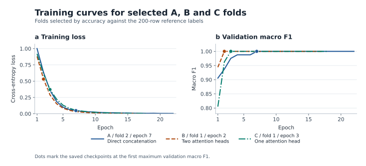

# 高炉工况三分类

每行使用固定的 24 个工艺量，按 6 组独立编码。A 版直接拼接组向量，B 版先做一层屏蔽对角线的组间注意力，再用相同规格的分类头。网络接收标准化后的 `float32[B,24]`，输出 `float32[B,3]` logits。

## 在指定环境运行

下面的 PowerShell 命令使用工作区实际提供的 GB18030 原始训练表，按名称提取 24 列。如果改用规格中的 UTF-8 BOM 导出表，替换 `--train` 的路径并省略 `--train-encoding gb18030`。

```powershell
Set-Location 'D:\work\blast_furnace'
$bfPython = 'D:\anaconda\envs\vjepa2-312\python.exe'
& $bfPython -X utf8 train.py `
  --train '..\数据集\traindata.csv' --train-encoding gb18030 `
  --test-input '..\数据集\test_input_sample.csv' `
  --test-labels '..\数据集\test_output_sample.csv' `
  --out-dir results_new
```

结果目录须为空。省略两个测试参数可运行内部评估及最终重训。只传测试输入则另存全部预测。测试行数或标签契约不符时，报告实际形状，外部计分等待确认。

## 加载模型推理

```powershell
& $bfPython -X utf8 predict.py `
  --checkpoint '.\results\B_final.pt' `
  --input '..\数据集\test_input_sample.csv' `
  --output '.\B_predictions.csv'
```

推理默认读取 GB18030，UTF-8 输入可加 `--encoding utf-8-sig`。`predict.py` 根据权重文件自动识别 A、B、C 版本。C 版可传入 `--checkpoint '.\results_c\C_final.pt'` 或其他已保存的 C 版权重。预测列为 `row_id,pred_label,p0,p1,p2`，行号从 1 起。权重文件内含 scaler 均值与尺度、24 列清单、分组、类别顺序及训练配置。

## 结果目录

### A/B/C 最佳折曲线

按 200 行区间参考标签选出的权重为 A 第 2 折、B 第 1 折、C 第 1 折。C 第 4 折并列，图中展示第 1 折。左图为逐轮训练交叉熵，右图为各自验证集的宏 F1。圆点标记各折保存权重的轮次（A 第 7 轮、B 第 2 轮、C 第 3 轮）。



[下载 PDF 矢量版](figures/best_fold_training_curves.pdf)

### 训练生成的文件

- `report.md` 和 `metrics.json` 分别提供可读报告和机器可读指标，包含五折、折外汇总及可用的独立测试样例结果。
- `splits.json` 保存 0 基原始行索引。`oof_A.csv`、`oof_B.csv` 按原始顺序保存 500 行折外预测，并附真实类别和折编号。
- `test_A.csv`、`test_B.csv` 按原始顺序保存全部测试预测。有标签且对齐条件满足时附 `true_label`，后 50 行留空。
- `A_final.pt`、`B_final.pt` 为全量重训权重。各折的最佳权重和训练历史分别保存。`run.json` 记录依赖版本、设备、配置和实际命令。

## 检查全量训练集能否拟合到 100%

从原 A/B 最终权重开始，用新初始化的 AdamW 继续训练。每轮用推理模式检查原训练集的全部 500 行，首次达到 500/500 时停止。脚本将指标、逐行预测和权重写入新目录。这是训练集拟合指标。

```powershell
& $bfPython -X utf8 fit_train100.py `
  --train '..\数据集\traindata.csv' --train-encoding gb18030 `
  --checkpoints results --out-dir results_train100_new
```
